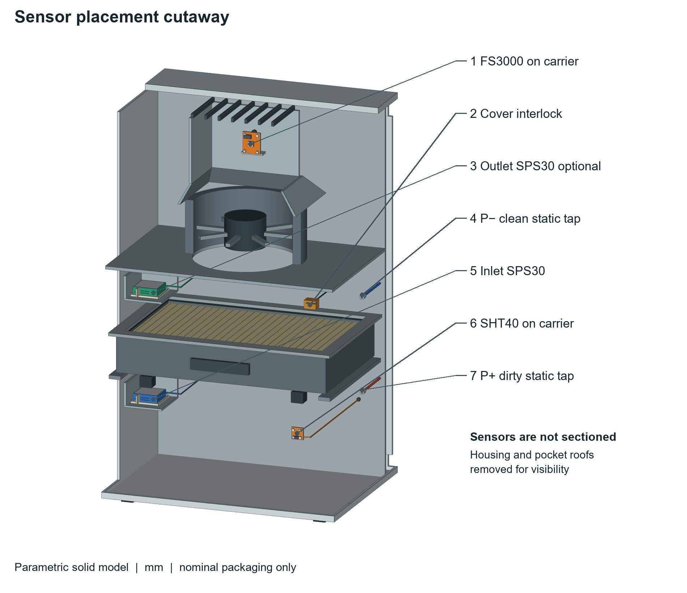
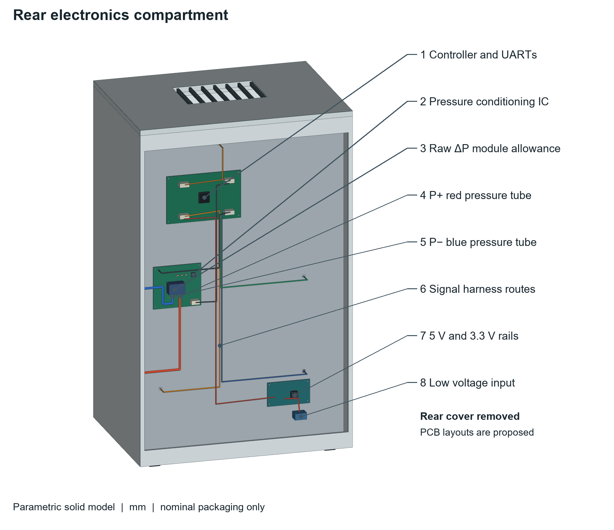
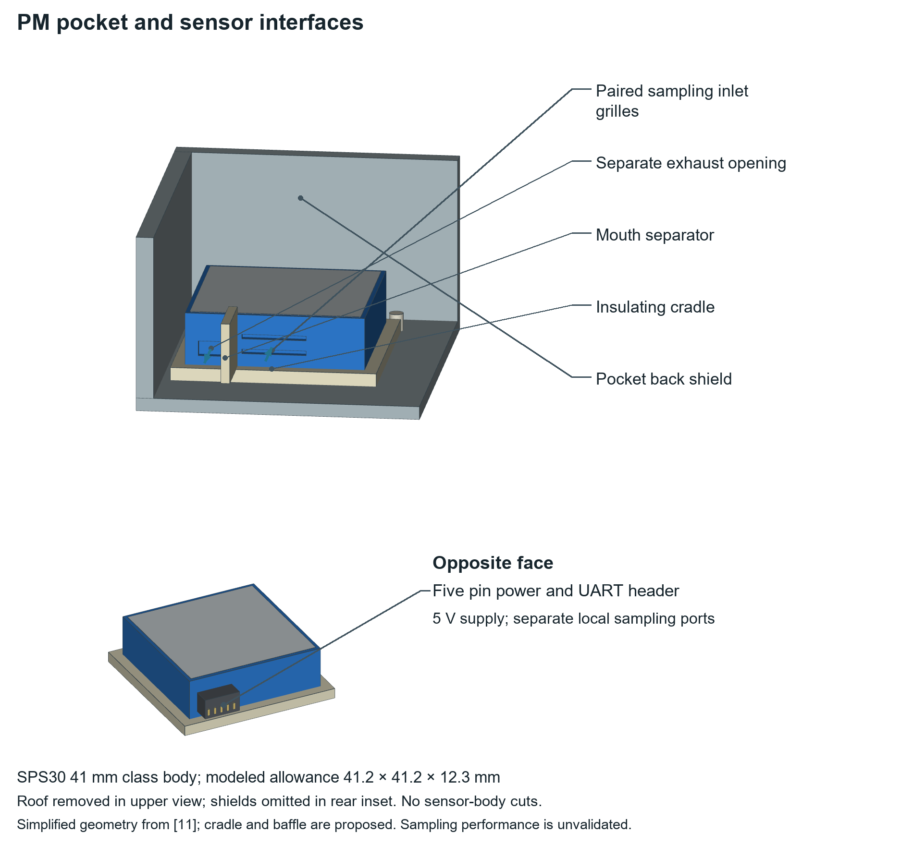
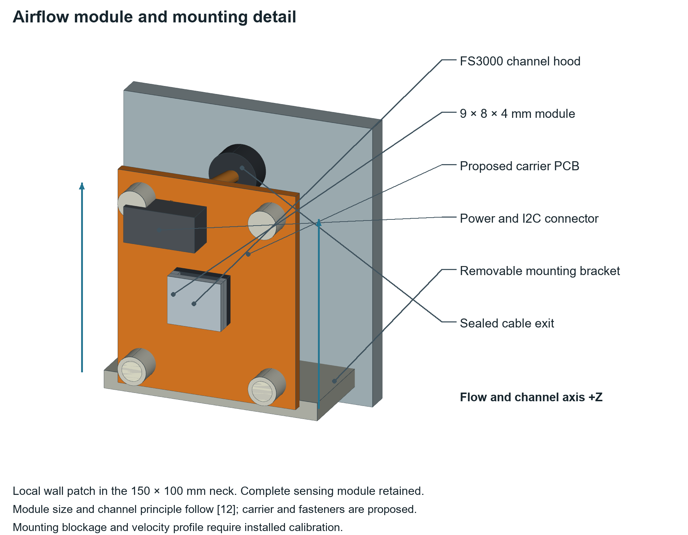
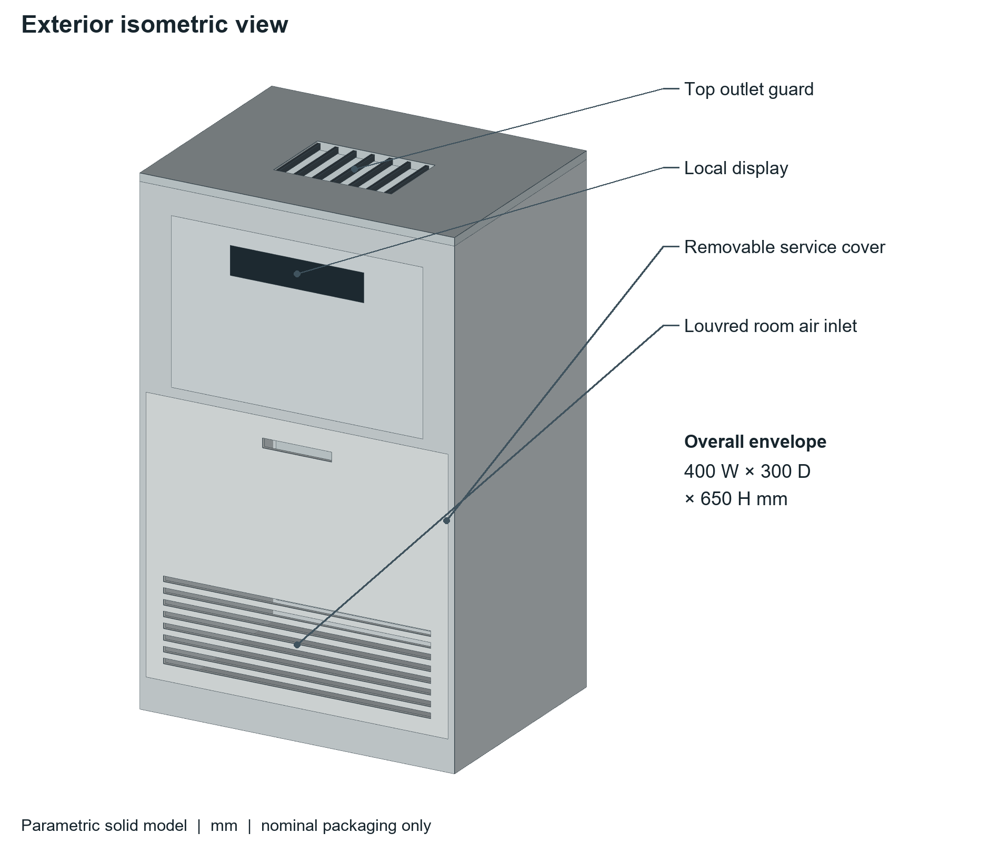
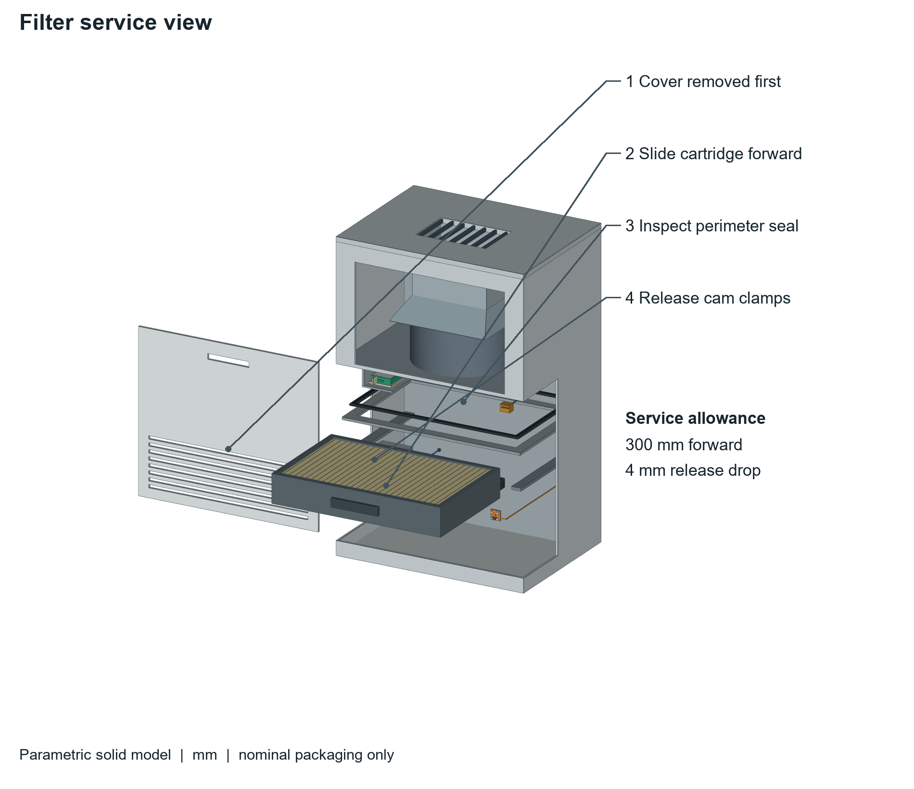

# Sensor aware air purifier CAD

A sensor-placement and mechanical-packaging proposal for a recirculating air purifier, developed for MA4822 Measurement and Sensing Systems.

The design makes the sensing hardware inspectable: two particle-sensor pockets, independent airflow sensing, environmental sensing, filter differential-pressure taps, a cover interlock and a separate rear electronics compartment. The intended diagnostic distinguishes restricted air delivery from evidence of poor installed particle removal.

**Status:** design proposal, not a built or experimentally validated purifier. The model does not establish manufacturing readiness, air-cleaning performance, safety compliance or patent novelty.



## Open the model

Download [purifier_assembly.step](purifier_assembly.step) using GitHub's download control, then import it into a STEP-capable CAD application. The neutral STEP assembly is provided alongside the editable parametric Python source. It is not a native SOLIDWORKS part or assembly file.

- Units: millimetres.
- Cabinet envelope: 400 mm wide by 300 mm deep by 650 mm high.
- Coordinates: front is negative Y; vertical airflow is generally positive Z.
- Filter cartridge allowance: 360 by 230 by 60 mm.
- Main plenum gross section: 380 by 250 mm.
- Outlet neck gross section: 150 by 100 mm.
- Rear electronics space: approximately 36 mm deep.

Dimensions are nominal design allowances, not production tolerances. Fan geometry reserves packaging space; it is not a selected fan with a verified pressure map.

## What the model contains

| Element | Representation and intended role |
| --- | --- |
| Upstream and downstream PM modules | Simplified SPS30-class bodies with paired inlet grilles, separate exhaust openings, opposite-face connectors and insulating cradles |
| Independent airflow module | Simplified FS3000 envelope on a proposed carrier, with the channel axis along +Z, removable bracket, connector and cable exit |
| Temperature and humidity | SHT40 package on a separate proposed carrier near entering room air |
| Filter pressure channel | Dirty-side P+ and clean-side P− static taps routed to separate ports of a proposed raw differential-pressure module |
| Rear electronics | Proposed controller, pressure-conditioning PCB, power conversion, low-voltage input and harness routes |
| Service features | Removable front cover, slide-out cartridge, gasket, clamp locations and cover interlock |

The sensor cutaway removes selected housing and duct walls, not the sensor bodies. The rear view removes the rear cover. The PM detail omits a pocket roof and includes an opposite-face inset so sampling openings and the connector can both be seen. The service view separates the cover and lifts the gasket for visibility; those are not normal operating positions.

### Rear electronics



### PM pocket and sampling interfaces



### Airflow sensor integration



### Exterior and service views





## Files

```text
purifier_assembly.step         Neutral STEP assembly
cad_assembly.py               Editable CadQuery geometry and rendering source
cad_*.png                     Six annotated views used in the report
cad_checks.json               Per-part validity, bounds and STEP round-trip checks
sensor_visibility.json
                             Retained sensor volumes and projected label anchors
requirements.txt             CAD and rendering dependencies
```

## Regenerate the assembly and views

The source was executed with Python 3.12, CadQuery 2.6.1, cadquery-ocp 7.8.1.1.post1 and VTK 9.3.1 on Windows. Rendering currently uses Windows Arial font paths. Other operating systems require adapting those paths and providing a suitable VTK/OpenGL rendering environment.

Create a fresh environment and install the dependencies:

```powershell
py -3.12 -m venv .venv
.\.venv\Scripts\python.exe -m pip install -r requirements.txt
.\.venv\Scripts\python.exe cad_assembly.py
```

Generated STEP, views and check files are written to `generated/sensors/`. The committed files in the repository root are the report snapshot, not automatically overwritten by regeneration. The source's optional relative `tmp/cad_runtime` search path supported its original isolated build environment; it is not required when dependencies are installed in the active environment.

## Verification and limits

The published snapshot contains 170 named geometric parts, including repeated contacts, fixings, guard bars and pleat indicators. The CAD kernel accepted their individual shapes, their bounding boxes lie within the stated cabinet envelope, and the exported STEP was re-imported and checked for validity. The visibility inventory checks that the selected sensor bodies retain their full modeled volumes in the cutaway.

These checks **do not prove** freedom from interference, adequate tolerances, structural strength, sealing, electrical correctness or representative sampling. The part count is an inventory, not a performance metric. Inspect the drawings as well as the numerical check files.

Important integration work remains:

- Verify local speed, pressure balance, sample exchange and sample representativeness at both PM pockets. Their intake and exhaust remain in the same local plenum; the pressure tubes are not particle-sampling tubes.
- Calibrate the relationship between local FS3000 velocity and total outlet flow. A short duct and mounting bracket do not establish a uniform velocity profile.
- Select the raw pressure transducer, fan, connectors and detailed PCB layouts. Their present geometry is a proposed packaging allowance.
- Verify cartridge sealing, housing leakage, cover interlocking, fan vibration, acoustic behaviour and electrical safety.
- Confirm supply rails and interfaces: SPS30 uses 5 V and separate UART channels in this layout; FS3000 and SHT40 use regulated 3.3 V with suitable I2C connections. Harness solids show routes, not individual pin assignments.

No CFD, prototype test, MATLAB result or measured diagnostic accuracy is included in this CAD snapshot. Analytical and simulation claims belong to separately identified calculations, not to the CAD validity checks.

## Manufacturer references

The sensor bodies are simplified models based on public package documentation, not supplier CAD. Carrier boards, mounting brackets, PM pockets and electronics layouts are proposed.

1. [Sensirion SPS30 data sheet](https://sensirion.com/file/datasheet_sps30): PM module outline and electrical interfaces. Modeled packaging allowance is 41.2 by 41.2 by 12.3 mm; small surface features are simplified.
2. [Renesas FS3000 data sheet](https://www.renesas.com/en/document/dst/fs3000-datasheet?language=en): 9 by 8 by 4 mm module envelope and directional flow channel.
3. [Sensirion SHT4x data sheet](https://sensirion.com/file/datasheet_sht4x): 1.5 by 1.5 by 0.54 mm package, distinct from the proposed 20 by 20 mm carrier.

Figure labels containing reference numbers [11], [12] or [13] retain the numbering used in the associated report; they correspond to the three manufacturer references above.

## Academic scope and reuse

This repository provides the CAD and preview evidence for an academic design proposal. The submitted report, student identifier, lecture slides and proprietary manufacturer CAD are not included. No open-source licence is granted by this repository; public availability alone does not grant reuse rights. Manufacturer names identify candidate components and do not imply endorsement.
