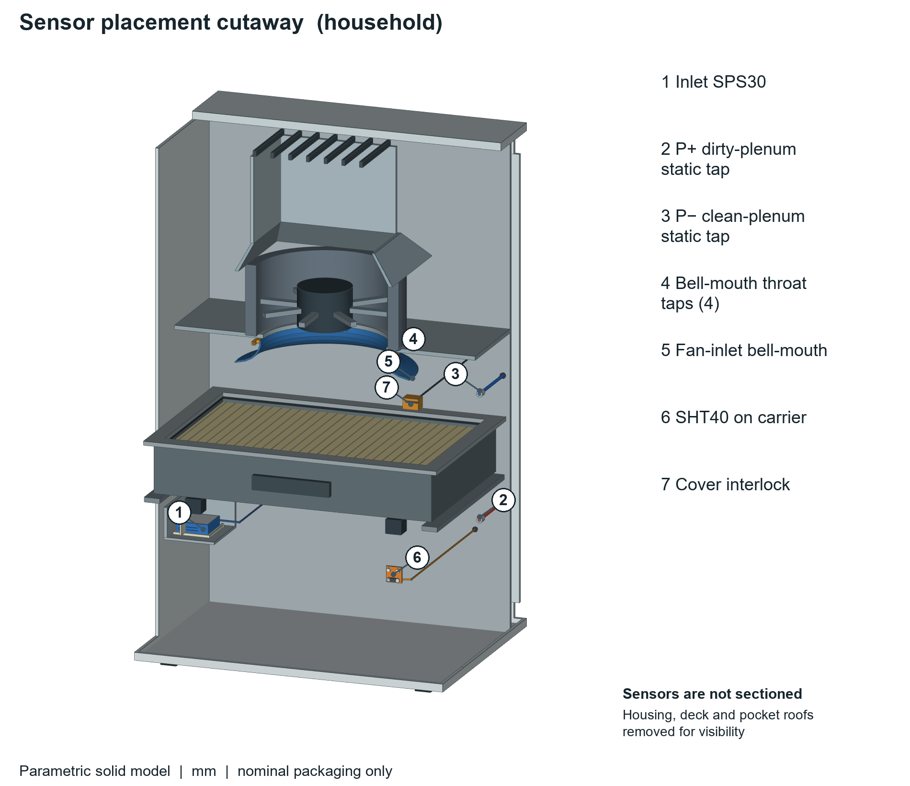

# Sensor aware air purifier CAD

A sensor-placement and mechanical-packaging proposal for a recirculating air purifier, developed for MA4822 Measurement and Sensing Systems.

**Rev D verified (18 November 2026).** The model now builds two configurations from one source: the **household** product and the **bench** development rig. See [Configurations](#configurations).

The household design measures filter pressure drop and fan-inlet airflow with two differential-pressure channels, controls the fan from an inlet particle sensor, flags humidity with an SHT40 and checks the service cover with an interlock. The diagnostic compares filter resistance with the commissioned clean-filter curve at the measured airflow to distinguish a restricted filter, weak delivery and a seal bypass.

**Status:** design proposal, not a built or experimentally validated purifier. The model does not establish manufacturing readiness, air-cleaning performance, safety compliance or patent novelty.



## Open the model

Download [purifier_assembly.step](cad/purifier_assembly.step) using GitHub's download control, then import it into a STEP-capable CAD application. The neutral STEP assembly is provided alongside the editable parametric Python source. It is not a native SOLIDWORKS part or assembly file.

- Units: millimetres.
- Cabinet envelope: 400 mm wide by 300 mm deep by 650 mm high.
- Coordinates: front is negative Y; vertical airflow is generally positive Z.
- Filter cartridge allowance: 360 by 230 by 60 mm.
- Main plenum gross section: 380 by 250 mm.
- Outlet neck gross section: 150 by 100 mm.
- Fan-inlet bell-mouth: 160 mm throat, 228 mm lip, four throat static taps at Z = 390 mm.
- Rear electronics space: approximately 36 mm deep.

Dimensions are nominal design allowances, not production tolerances. Fan geometry reserves packaging space; it is not a selected fan with a verified pressure map.

## Configurations

| Element | Household (product) | Bench (development rig) |
| --- | --- | --- |
| Inlet PM module (SPS30 class), shielded pocket below the cartridge | Yes | Yes |
| Filter differential pressure: P+ dirty-plenum and P− clean-plenum static taps, raw bridge module with INA333 conditioning | Yes | Yes |
| Airflow: fan-inlet bell-mouth (160 mm throat, 228 mm lip), four throat static taps, tap ring manifold, digital flow ΔP module (SDP810 class) referenced to the shared P− tap | Yes | Yes |
| SHT40 temperature and humidity on a carrier near the room-air inlet | Yes | Yes |
| Cover interlock, removable cartridge, compressed perimeter gasket, two cam clamps | Yes | Yes |
| Outlet PM module (SPS30 class) above the cartridge | — | Yes, reference for seal tests |
| FS3000 thermal velocity sensor in the outlet neck | — | Yes, cross-check during bell-mouth calibration |

The fan deck opening equals the bell-mouth throat, so all air reaching the fan passes the throat taps. Pressure tubes and harnesses pass through holes in the rear partition fitted with sealed feedthroughs or grommets.

## Regenerate the assembly and views

Tested environment for this verified revision: Python 3.12, CadQuery 2.6.1, cadquery-ocp 7.8.1.1.post1 and VTK 9.3.1 on Windows. Both configurations were generated and checked with the actual OpenCascade geometry kernel. See VALIDATION.md for the corrections and check results.

```powershell
py -3.12 -m venv .venv
.\.venv\Scripts\python.exe -m pip install -r requirements.txt
.\.venv\Scripts\python.exe cad_assembly.py                      # both configurations
.\.venv\Scripts\python.exe cad_assembly.py --config household   # one configuration
.\.venv\Scripts\python.exe cad_assembly.py --step-only          # STEP and checks, no rendering
```

Outputs are written to `generated/household/` and `generated/bench/`:

```text
purifier_assembly.step     neutral STEP assembly for that configuration
cad_exterior.png           exterior isometric
cad_sensor_cutaway.png     sensor placement cutaway
cad_rear.png               rear electronics bay
cad_service.png            filter service view
cad_pm_detail.png          inlet PM pocket detail
cad_flow_detail.png        bell-mouth, throat taps and manifold (seen with the fan deck omitted)
cad_fs3000_detail.png      bench only: FS3000 reference sensor
cad_checks.json            validity, envelope, STEP round trip, interference report
sensor_visibility.json     retained sensor volumes and label anchors
```

The committed household STEP is available at `cad/purifier_assembly.step` and at the root compatibility path `purifier_assembly.step`; both files are identical. Household previews are in `images/` and at the root compatibility paths. The [bench STEP](cad/bench/purifier_assembly.step) and previews in `images/bench/` are separate development-rig files. Check records are in `validation/household/` and `validation/bench/`. Regeneration writes to `generated/`, which is ignored by Git; copy the selected files into these published paths when updating the snapshot. Rendering uses Windows Arial and falls back to DejaVu Sans elsewhere. Run `python verify_geometry.py` after generation for the additional pressure-connection checks.

## Verification and limits

`cad_assembly.py` asserts that every part is a valid solid, that all parts lie inside the 400 × 300 × 650 mm envelope, that the STEP file re-imports as a valid shape, that every required sensing element exists, that the household build contains no bench-only part, and that the cutaway removes no sensor body. The bell-mouth outer profile is offset normal to its inner segments; the closed ring manifold has an internal gallery and four communicating bores. Tubes and harnesses remain solid routing envelopes for packaging, not complete fluid-domain or cable models. It also intersects every new rev D part with every other part whose bounding box it touches and writes the overlaps to `cad_checks.json`. Tube junctions and tube ends seated in ports are reported as `intended_joint: true`; anything in `unexpected_interferences` needs attention.

These checks **do not prove** adequate tolerances, structural strength, sealing, electrical correctness or representative sampling. Inspect the views as well as the check files.

Remaining integration work:

- Calibrate the bell-mouth discharge coefficient on the bench rig against the FS3000 and a reference flow; confirm flow repeatability across cartridge refits.
- Verify sample exchange and representativeness in the inlet PM pocket.
- Select the raw pressure transducer, fan, connectors and PCB layouts; present geometry is a packaging allowance.
- Verify cartridge sealing, housing leakage, cover interlocking, fan vibration, acoustics and electrical safety.
- Confirm supply rails and interfaces: the SPS30 uses 5 V and UART; the flow ΔP module, SHT40 and (bench) FS3000 use 3.3 V I²C.

## Manufacturer references

The sensor bodies are simplified models based on public package documentation, not supplier CAD. Carrier boards, mounting brackets, PM pockets, bell-mouth and electronics layouts are proposed.

1. [Sensirion SPS30 data sheet](https://sensirion.com/file/datasheet_sps30): PM module outline and interfaces; modelled allowance 41.2 × 41.2 × 12.3 mm.
2. [Sensirion SDP8xx data sheet](https://sensirion.com/products/catalog/SDP810-125Pa): digital differential-pressure sensor for the bell-mouth channel; modelled as a 26 × 17 × 16 mm allowance with two ports.
3. [Sensirion SHT4x data sheet](https://sensirion.com/file/datasheet_sht4x): 1.5 × 1.5 × 0.54 mm package on a proposed 20 × 20 mm carrier.
4. [Renesas FS3000 data sheet](https://www.renesas.com/en/document/dst/fs3000-datasheet?language=en): bench reference only; 9 × 8 × 4 mm module.

## Academic scope and reuse

This repository provides the CAD and preview evidence for an academic design proposal. The submitted report, student identifier, lecture slides and proprietary manufacturer CAD are not included. No open-source licence is granted by this repository; public availability alone does not grant reuse rights. Manufacturer names identify candidate components and do not imply endorsement.
